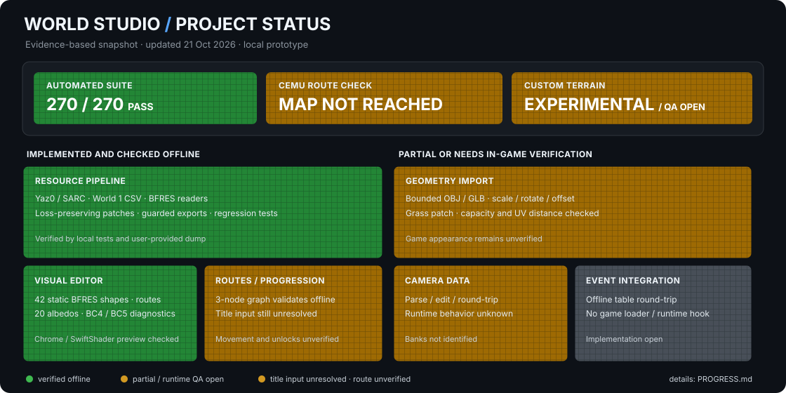

# NSMBU World Studio

**A research and editing toolkit for New Super Mario Bros. U world maps.**

World Studio reads and edits selected world-map resources, builds experimental topology and terrain patches, and provides an integrated desktop editor with a persistent 3D world viewport. A matched Cemu test from the same tower and with identical held inputs reached Tilted Tunnel on Clean and Blooper’s Secret Lair on Chain, verifying a changed route destination; a separate Chain run entered Blooper’s Secret Lair. The experimental terrain projector now dampens height edits that would invert existing W1 grass faces in the offline mesh check. Its updated appearance and collision have not yet been confirmed in Cemu. Exact in-game point IDs, level completion, progression, save persistence, and a complete playable custom overworld are not yet verified.



Progress details and dated findings: [PROGRESS.md](PROGRESS.md) · [Runtime test notes](docs/INTEGRATION.md)

## What works today

- Read Yaz0/SARC archives and export patched archives while preserving untouched members. Export manifests list every changed member with before/after SHA-256 hashes and byte sizes, alongside archive-level hashes.
- Read and edit World 1 point and route tables; validate references before export. The point editor can draft a normal or secret connection using a unique shortest existing BFRES endpoint chain, add its missing route-table rows, and apply the destination/path pair as one undoable edit. Ambiguous paths remain blocked; static names do not establish in-game route behavior.
- Choose route movement types from the source archive's existing type values. Changed/new route rows with empty or unknown types are blocked from export; unchanged source values remain preserved.
- Inspect supported BFRES skeletons and apply bounded bone-transform changes.
- Export an experimental three-node progression patch using existing route data.
- Import a bounded rigid OBJ or static glTF 2.0 terrain surface (`.glb` or `.gltf`) and project its upward-facing triangles onto the existing main grass mesh. The embedded viewport shows this export-equivalent projected shape, not raw imported topology. Export preserves source vertex/index topology, material, diffuse UVs and baked-light UVs, displaces only overlapping upward-facing source vertices, and recomputes normals and bounds; terrain collision and Cemu appearance still require in-game verification. All formats offer scale, XYZ rotation (including a Z-up to Y-up preset) and translation before preview or export. glTF accepts static triangle meshes, float32 positions/normals, and float32 or normalized unsigned-byte/short `TEXCOORD_0`, with a 64 MiB input/aggregate-buffer limit, 65,535-vertex, 200,000-triangle and 4,096-primitive limits. `.glb` uses one embedded BIN buffer; `.gltf` accepts up to 16 local relative sidecar buffers or base64 data URIs, blocks network and directory-escaping paths, and checks each declared byte length. A local W1 `.gltf` sidecar has passed project save/reopen and topology-preserving BFRES archive export checks. Hierarchical TRS and affine node matrices are applied to positions and inverse-transpose normals; mirrored transforms reverse triangle winding, and repeated meshes on separate nodes are expanded within geometry limits. Primitives missing normals get generated smooth normals, while missing UVs use a planar terrain fallback; both are reported. Compressed data, skinning, morph targets, repeated-node DAG instancing, singular/projective transforms, required extensions and material rendering remain unsupported and are reported or rejected.
- On project reopen, separate SHA-256 fingerprints detect changed imported terrain positions/topology and UV/normal attributes; older projects retain their geometry-only fingerprint. Source OBJ material-library edits remain outside the imported data model.
- Embed the offline WebGL world renderer as the primary graph-editing surface on Windows through a local Tk child WebView2. A larger, full-height graph is docked inside the 3D viewport by default, and the WebGL canvas resizes beside it so the graph does not cover the world. The SVG layout scales with the viewport, and older layout preferences migrate to this integrated view. Labels are automatically repositioned to reduce overlap, and crowded point names remain available on hover. Selecting a point or route in the docked graph, 3D scene, or nodes/routes list synchronizes selection and camera focus. Drag points in the 3D scene to edit their positions. The synchronized native 2D graph remains an optional side panel. Preview controls opens lighting, camera, filters, visibility and the shape inspector. Native point and route-table edits update WebGL and graph without rebuilding BFRES geometry or textures. Terrain geometry changes rebuild the scene.
- Render 42 supported static shapes from the local World 1 BFRES (70,193 vertices and 106,736 triangles), with route overlays, per-shape visibility controls, viewport and list mesh selection, geometry/material details, read-only texture SRT metadata, base-color and diagnostic BC3/BC4/BC5 map previews with supported storage formats and dimensions, trilinear mipmapping for power-of-two base-color textures, visible per-shape warnings when a base texture falls back to approximate color, focus-to-mesh framing, front/side/top camera presets, editable preview target coordinates, adjustable preview-light direction/intensity, deduplicated wireframe, and sampled vertex-normal views. The preview applies the locally verified mode-0, zero-rotation `texmtx0` scale/translation to named native route albedo sampling and picking; unsupported SRT modes/rotations remain unapplied. Native route albedo edges now blend after the terrain instead of using a hard alpha cutoff; this targets camera-scale edge popping but does not reproduce the complete route shader or eliminate every W1M0 geometry/texture fragment. A dedicated `_c0` diagnostic decodes GX2 `0x00A` UNorm8x4 and `0x80F` half-float4 vertex colors, reports raw channel ranges, and clamps RGB to 0–1 for display; shader meaning and alpha behavior remain unverified. The viewer reads supported `_a0` GX2 wrap modes: Wrap and Mirror map directly, Clamp is marked as an edge approximation, and unsupported modes are reported with an explicit Repeat fallback. Repeated preview builds reuse parsed indexes for the unchanged local BFRES and shader archive.
- Selecting a UV-mapped shape also shows its raw triangle layout, stored UV bounds, the number of vertices outside the 0–1 tile, and valid/invalid triangle counts. Dense charts are sampled and extreme ranges are clipped for display. The chart does not apply texture SRT or claim shader accuracy.
- Inspect SHARCFB v8 archives without decoding proprietary GX2 instructions. When the local common shader archive is available, the material inspector resolves BFRES shader-program assignments, sampler/uniform symbols, material-option permutation candidates, and declared shader-input to BFRES vertex-attribute bindings with stored formats. Shape-specific skinning selection and actual game shader execution remain unresolved.
- Decode shared BC1/BC3 base-color textures for all 42 local W1 shapes with verified `_u0` data, including alpha cutouts. The reader supports float32x2, Float16x2, UNorm16x2, SNorm16x2, SNORM8x2, and UNorm8x2 UV formats across local world models; other texture transforms and shader operations remain unverified.
- Inspect BC5 SNORM R/G channels for eight shared `_n0` maps across 26 UV meshes, or enable optional tangent-space lighting reconstructed from those maps and generated mesh tangents. The lighting preview is approximate; channel orientation and game material settings remain unverified.
- Pack scene geometry into compact typed buffers for the viewer; the current generated page with all supported decoded W1 maps is 22,034,943 bytes (21.01 MiB). This payload size is not a load-performance benchmark.
- Validate directed reachability with `validate-graph`, and block project exports when a new local destination lacks a route chain or an edited route disconnects a destination that was connected in the baseline.
- Read and edit discovered camera-offset tables; analyze, inventory, and round-trip event data offline. The Cobra catalog reports script priorities, counts, and numeric command IDs without guessing their effect or linking them to world points.
- Use the Tk editor to inspect the map, drag supported rest-pose points in the embedded 3D viewport, edit fields from the side panel or 3D selection, save, and undo or redo up to 31 edits with Ctrl+Z / Ctrl+Y. The 3D world is the main graph editor: a selectable, full-height graph is docked inside the viewport and open by default; the WebGL canvas resizes beside it to keep both the topology and world visible. **Open 2D graph panel** shows the optional synchronized native graph beside the viewport. The viewer uses a small constant clip-space depth bias on named native route meshes and a tighter zoom-dependent near plane to preserve more depth-buffer precision where roads meet grass. Supported mode-0, zero-rotation route `texmtx0` scale/translation is applied to road albedo sampling and picking; small W1M0 fragments and visual stability in the rebuilt desktop app still need a fresh orbit check, while game-renderer behavior remains unverified. The integrated graph's show/hide and expand controls remain available in the embedded toolbar. 3D drags commit through the hierarchy-aware world-to-local converter; transforms that cannot be safely inverted are rejected. The 3D view is built in a background worker; edits are paused only during a full geometry rebuild, while point/route changes update graph overlays incrementally. Its Recent menu remembers the last ten paths separately for native worlds and lightweight previews in the user's local application settings, and reopens them through the normal unsaved-edit guard. Changed native sessions and saved lightweight-preview projects get a debounced recovery snapshot capped at 64 MiB and bound to the source file hash; reopening offers restore. Overwriting a changed project preserves two recent versions as neighboring backup files. Export validation rejects malformed rows and invalid bone positions; unsupported transforms stay in a labeled preview layout.
- Run the local automated suite against synthetic fixtures and the user-provided local dump.

The WebGL viewer supports BC1/BC3 base-color maps, BC5 SNORM normal-map channels, BC5 UNorm `_o0` channels, and BC4 UNorm diagnostics from `_o1`, `_b0`, `_s0`, and `_x2` in the observed local GX2 2D Thin1 layout. A selector switches among 19 BC4 maps attached to the 42 supported W1 shapes. The inspector also shows `_x0`/`_x1` BC3 thumbnails and exact sampler names declared by each resolved material shader program, including route-mask, edge-mask, light-map, bake-map, spec-mask, and normal-map symbols. Those views remain diagnostic texel displays; shader calculations and active compiled variations are not evaluated. An AGL-style option lookup reports a candidate material permutation index, while the form-specific skinning selection is unresolved. The inspector reports bounded `texmtx` SRT fields and matching shader uniform names where available. The preview applies only the bounded mode-0, zero-rotation `texmtx0` scale/translation to named native route surfaces; other transforms and sampler semantics are unresolved. Optional BC5 tangent-space lighting uses generated mesh tangents and reconstructed Z, but channel orientation and game material lighting remain unverified. Preview-light controls are illustrative. The static BFRES reader also decodes local `_u0` Float16x2 (`0x808`) and SNORM8x2 (`0x204`) attributes found in W3/W5a/W7/W8a/W8b. The viewer does not reproduce complete game shaders, animation, or arbitrary BFRES variants. The editor deliberately blocks unsupported node/index changes. Camera and event formats have offline tooling, but their in-game behavior and runtime integration are not verified. Read [Research and format findings](docs/RESEARCH.md), [Resource findings](docs/RESOURCE_FINDINGS.md), [Camera findings](docs/CAMERA_FINDINGS.md), and [Event findings](docs/EVENTS.md) for the evidence and limits of each feature.

For the integrated viewport, the embedded graph inset, editor list, optional 2D graph, and 3D world select the same supported point/route overlays; selecting in any view updates the other views and focuses the camera. Graph edges resolve through a unique shortest chain in the native route table, and each visible edge gets a distinct editable segment row when the data supports an unambiguous mapping. Selected points glow in the scene, and selected route segments receive a bright overlay in the 3D world and optional 2D graph while the camera focuses on their midpoint. Left-dragging an editable native point commits its world position back to BFRES local coordinates, enters Undo history, and refreshes its overlay; child transforms that cannot be inverted are rejected. Point positions and route overlays refresh incrementally. Terrain geometry replacement reloads the viewport scene; model geometry is not rebuilt for ordinary point or route-table edits. BFRES shape inspection also preserves contiguous submesh index ranges and shows each part's triangle count. Shape inspection reports its rigid rest-pose bone binding when available, and “Select bound bone in editor” selects the corresponding point or editable bone row. Supported static BFRES object bones expose local XYZ position, Euler rotation and positive scale controls; bound shapes follow in the embedded preview, and Undo/Redo, project persistence and archive export preserve those transforms. Quaternion edits, special hierarchy modes and arbitrary BFRES geometry remain read-only. Items without a displayed world overlay (including unsupported-layout points) cannot be selected from the 3D canvas. The embedded host uses tkwry 0.1.9 and the installed WebView2 Runtime; if it cannot initialize, use the external-preview debug action. These editor features are not proof of in-game runtime behavior.

## Current runtime status

Matched process-bound Cemu tests started Clean and Chain at Crushing-Cogs Tower, with identical GamePad mappings, unchanged identical saves, and the same held `A → S → W` sequence (2,000 ms per direction). Clean reached **Acorn Plains-2 — Tilted Tunnel**; Chain reached **Blooper’s Secret Lair**. A separate Chain run entered Blooper’s Secret Lair and showed side-scrolling gameplay. Cemu does not show internal point IDs, so the W102/W103 archive mapping is still inferred. Course completion, unlock progression, post-clear save persistence, and patched terrain appearance remain unverified. The prior Mainlight terrain build had 905 faces inverted by height projection; the current offline exporter limits those height changes while preserving the source topology and UVs. The resulting terrain appearance and collision still need a Cemu check. See [the integration log](docs/INTEGRATION.md) and [the dated progress log](PROGRESS.md).

## Get started

Requirements: Windows, Python 3.14 with Tkinter, Microsoft Edge WebView2 Runtime, and the optional `tkwry` host for the embedded viewport. Install it with `python -m pip install -r requirements.txt`. A legally obtained NSMBU dump is needed for resource work; Cemu is optional for isolated runtime tests. If `tkwry` is unavailable, the app offers the existing external preview as a fallback.

```powershell
python -m worldstudio gui
```

Or double-click `Launch World Studio.cmd`. By default the editor looks for the local game resource at `NSMBU Modding Project/content/Common/course_select/CS_W1.szs`. The dump is not included in this repository.

Inspect resources and create a sample topology export:

```powershell
python -m worldstudio inspect
python -m worldstudio demo --out build/my-chain
python -m worldstudio gui build/my-chain/three-level-chain.nws.json
```

Require the explicit World 1 entry/required-location graph profile when exporting:

```powershell
python -m worldstudio export build/my-chain/three-level-chain.nws.json --out build/my-chain/profile-checked.szs --profile profiles/w1-core-progression.json
```

This optional check blocks export if W101 cannot reach W102 and W103. It checks
the selected static profile only; it does not model save flags or game unlocks.
The native editor offers the same check from the **Graph check** toolbar menu.
**Validate** and SZS export both apply the selected JSON profile. The choice is
remembered in per-user settings for that exact source archive hash and reloaded
only when its profile still parses for the world; a missing or mismatched
profile leaves the gate off with an explanation. A successful profile-gated
export records the normalized profile and its SHA-256 in the manifest while
keeping `game_tested: false`.

After exporting a saved project, reimport the archive and compare every member,
the export manifest, and any camera companion files against a fresh export:

```powershell
python -m worldstudio verify-export build/my-chain/three-level-chain.nws.json build/my-chain/content/Common/course_select/CS_W1.szs
```

This checks offline package consistency; its report keeps `game_tested` false.
For a profile-gated export, pass the same profile to the verifier:

```powershell
python -m worldstudio verify-export build/my-chain/three-level-chain.nws.json build/my-chain/profile-checked.szs --profile profiles/w1-core-progression.json
```

Inspect the named interface in a local shader archive:

```powershell
python -m worldstudio inspect-shaders "NSMBU Modding Project/content/Common/course_select/CS_WorldMap.szs" --program mtWorldMap
python -m worldstudio inspect-shaders "NSMBU Modding Project/content/Common/shader/shaderfb.szs" --entry nw4f_cs_shader.sharcfb --program nw4f_cs_route_shader
python -m worldstudio inspect-shaders "NSMBU Modding Project/content/Common/shader/shaderfb.szs" --entry nw4f_cs_shader.sharcfb --program nw4f_cs_route_shader --json
```

The default is a compact terminal summary; add `--json` for the full parsed metadata.

Check a route from an explicit start to required locations:

```powershell
python -m worldstudio validate-graph --entry W101 --require W102 --require W103
```

For the checked-in World 1 static reachability profile, run `python -m worldstudio validate-graph --profile profiles/w1-core-progression.json`. The profile pins W101 as an explicit start and W102/W103 as required reachable locations; this checks native table connectivity and does not model events, unlock state, Mario movement, level loading, or save persistence.

Pass a saved `.nws.json` project path as the first argument to validate edits. Local route endpoints must resolve to the current BFRES; remote-world endpoints are left unresolved because their archive is outside the project. Remote segments cannot satisfy local reachability. This verifies the declared graph only; it does not simulate in-game movement or unlock rules.

The experimental mesh export accepts the included original sample island:

```powershell
python -m worldstudio demo --island assets/island.obj --out build/my-island
```

Exports go to new paths and include manifests. Never copy them over the original game files. For the isolated Cemu workflow, see [docs/INTEGRATION.md](docs/INTEGRATION.md) and `tools/prepare_cemu.py`.

## Verify locally

```powershell
python -m unittest discover -s tests -v
python -m compileall -q worldstudio tests tools
```

A fresh headless Chrome/SwiftShader render of the local W1 scene, mesh inspector, and preview-light panel was visually inspected. Cemu matched the same held A movement from Crushing-Cogs Tower to the next visible course node in Clean and Chain. A further Chain run used held S then W to reach the visible Blooper’s Secret Lair course node; configured Z opened it and live gameplay was observed. The internal point ID and whether that specific transition depends on the changed W102→W103 edge still need a same-position Clean comparison. Progression after clearing and save compatibility remain unverified. See [Runtime test notes](docs/INTEGRATION.md), [TESTING.md](docs/TESTING.md), and [ROADMAP.md](ROADMAP.md) for details and next milestones.

## Repository map

| Path | Purpose |
| --- | --- |
| `worldstudio/` | Resource readers, patch/export logic, and Tk editor |
| `tools/` | Cemu test setup and inspection/event bridge tools |
| `tests/` | Synthetic and user-dump-backed regression tests |
| `docs/` | Research notes, integration evidence, and progress graphic |
| `assets/` | Original CC0 preview geometry |
| `examples/` | Original CC0 game-space test geometry |
| `patches/` | Small upstream Cobra encoder fix and its license |

## Safety and licensing

No Nintendo game dump, executable, save, emulator build, or generated game-resource pack is distributed here. Supply your own legally obtained game files; local dump, build, and evidence folders are ignored by Git. The included island OBJ files are original project geometry and carry CC0 notices in their headers.

There is no repository-wide code license yet. The Cobra-related patch and bridge preserve the upstream GPL license notice in `patches/COPYING.Cobra`; see [docs/RESEARCH.md](docs/RESEARCH.md) for provenance and pinned upstream references.

## Contributing

Keep findings tied to reproducible evidence, preserve unknown resource bytes, and distinguish offline tests from Cemu or hardware observations. Update `PROGRESS.md` and the relevant format note when behavior changes. Do not add user-owned game dumps, saves, executables, generated packs, or credentials to commits.
